# Kakuro for the Game Boy

[](CHANGELOG.md)
[](LICENSE)
[](src)

Kakuro, the number crossword, for the Game Boy, in colour on the Game Boy
Color. There are 80 puzzles, from 6x6 to 8x8, in a 32 KiB ROM-only
cartridge without battery RAM: nothing is saved. Best times last until the
Game Boy is switched off, and a puzzle left unsolved is not kept at all.

[Play it in your browser](https://ifilot.github.io/kakuro-gb/), in the
[binjgb](https://github.com/binji/binjgb) emulator, on a Game Boy or a Game
Boy Color.

<p align="center">
  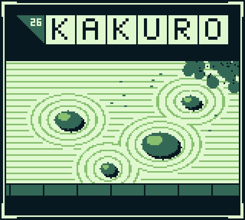
  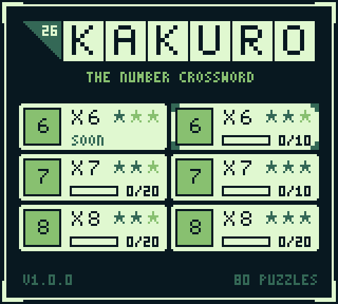
  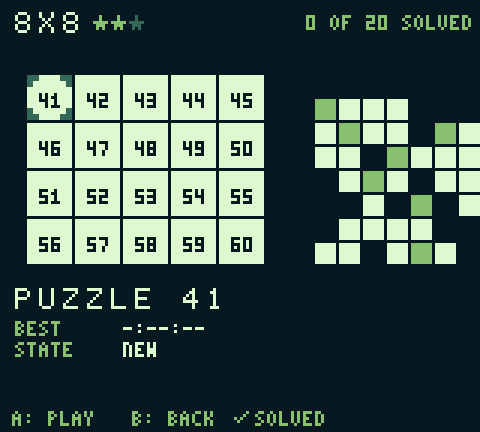
  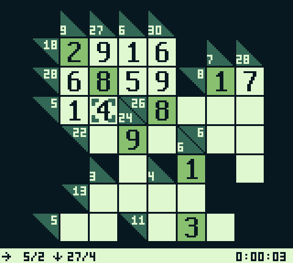
</p>
<p align="center">
  
  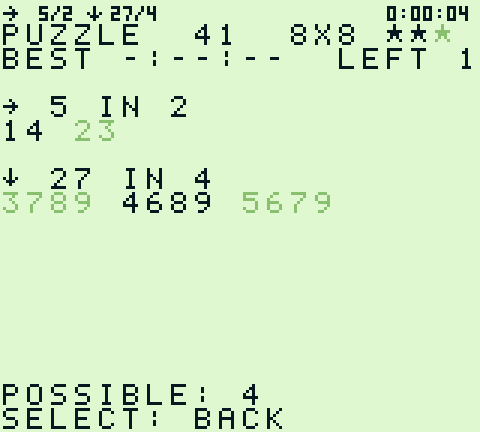
  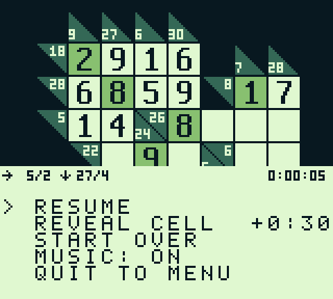
  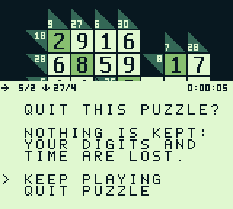
</p>
<p align="center">
  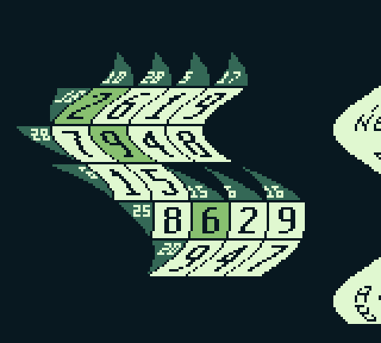
  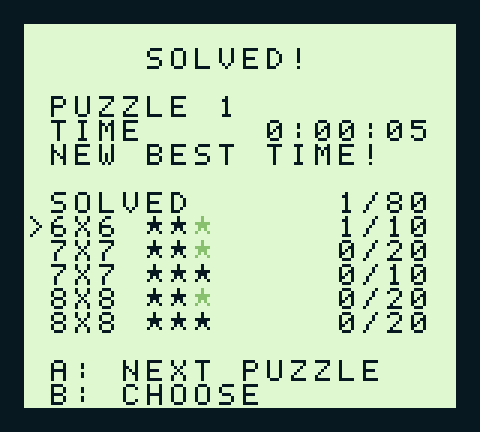
  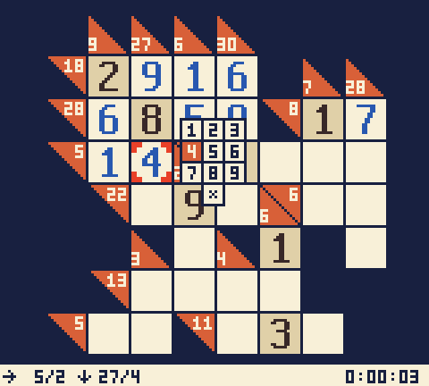
  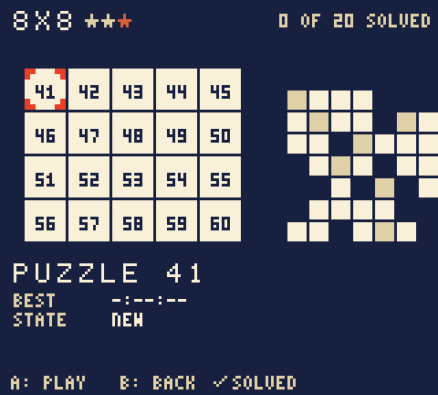
</p>

## Play

Load `build/kakuro.gb` in an emulator (mGBA, SameBoy, BGB, ...) or on a
flash cartridge. It plays in colour on the Game Boy Color and in shades on
the others.

Fill every white cell with a digit from 1 to 9 so that each run of white
cells adds up to the sum before it: the upper-right triangle is the sum of
the run to its right, the lower-left one of the run below. No digit repeats
within a run, and grey cells are given. Every puzzle has exactly one
solution.

| Button | On the board |
| --- | --- |
| D-pad | Move to the nearest white cell in that direction |
| A | Keypad: choose 1-9 or erase (x), A to put it, B to cancel |
| B | Wipe the cell |
| SELECT | Combinations of the cursor's runs |
| START | Pause: resume, reveal the cell (+30 seconds), start over, music, quit |

The status line shows the cursor's runs (`→20/4`, `↓16/2`) and the clock.
When stuck, SELECT lists every combination that makes each sum, plus the
digits the cell can still take.

On the title screen choose a size and difficulty, then a puzzle; solved
ones get a check mark. Nothing is saved: a puzzle is played in one go
(quitting loses it, so the game asks first), and best times last until the
Game Boy is switched off.

## Puzzles

The puzzles come from [kakuro-8bit](https://github.com/ifilot/kakuro-8bit)
(`assets/puzzles/e5`). That project also forbids two runs from using the
same set of digits; with the standard rules alone, 26 of them have more
than one solution. `tools/gen_puzzles.py` adds givens from the stored
solution (1 to 3 per puzzle) until each has exactly one.

| Puzzles | Grid (with the sums) | Difficulty |
| --- | --- | --- |
| 1-10 | 6 x 6 | ★★ |
| 11-30 | 7 x 7 | ★★ |
| 31-40 | 7 x 7 | ★★★ |
| 41-60 | 8 x 8 | ★★ |
| 61-80 | 8 x 8 | ★★★ |

A cell is 16x16 dots, so an 8x8 grid (128 dots) fits the 160x136 dots above
the status line whole. kakuro-8bit's 9x9 and 10x10 puzzles would not, and
are left out.

## Build

The game is C for [GBDK-2020](https://github.com/gbdk-2020/gbdk-2020)
(4.5.0). Nothing needs root: unpack the Linux release in your home
directory, which is where the Makefile looks by default (`GBDK_HOME`).

```sh
curl -sL https://github.com/gbdk-2020/gbdk-2020/releases/download/4.5.0/gbdk-linux64.tar.gz | tar xz -C ~
make                  # -> build/kakuro.gb, and the ROM space used
```

`make run` plays it in [mGBA](https://mgba.io) (`sudo apt install mgba-qt`;
`MGBA=` names another binary). The tests and screenshots use
[PyBoy](https://github.com/Baekalfen/PyBoy):

```sh
python3 -m venv ~/.venvs/pyboy && ~/.venvs/pyboy/bin/pip install pyboy pillow
make test PYTHON=~/.venvs/pyboy/bin/python
```

| Target | |
| --- | --- |
| `make` | Build `build/kakuro.gb` |
| `make run` | Play in mGBA (arrows; A = `x`, B = `z`, START = Return, SELECT = Backspace) |
| `make test` | Every puzzle solved in the emulator, see below |
| `make screenshots` | Every screen -> `build/screens/` |
| `make docs` | The pictures above, in Game Boy green -> `docs/` |
| `make puzzles` | Regenerate `src/puzzles.[ch]` from `assets/puzzles` |
| `make gfx` | Regenerate `src/gfx.[ch]`; tile sheet in `build/gfx_preview.png` |
| `make music` | Regenerate `src/music.[ch]` from the notes in `tools/gen_music.py` |
| `make listen` | The music as PyBoy plays it -> `build/music.wav` |
| `make site` | The website, the game in the browser -> `_site/` (checked) |
| `make serve` | The website at http://localhost:8000 |

Every push, to any branch, builds the ROM and runs `make test`
(`.github/workflows/build.yml`); a tag `v<version>`, matching
`src/version.h`, also publishes a release with the ROM, a zip and that
version's CHANGELOG section. Every push to `master` builds the website and
deploys it to GitHub Pages (`.github/workflows/pages.yml`); Pages must use
GitHub Actions as its source.

## License

GNU General Public License v3.0; see [LICENSE](LICENSE).
