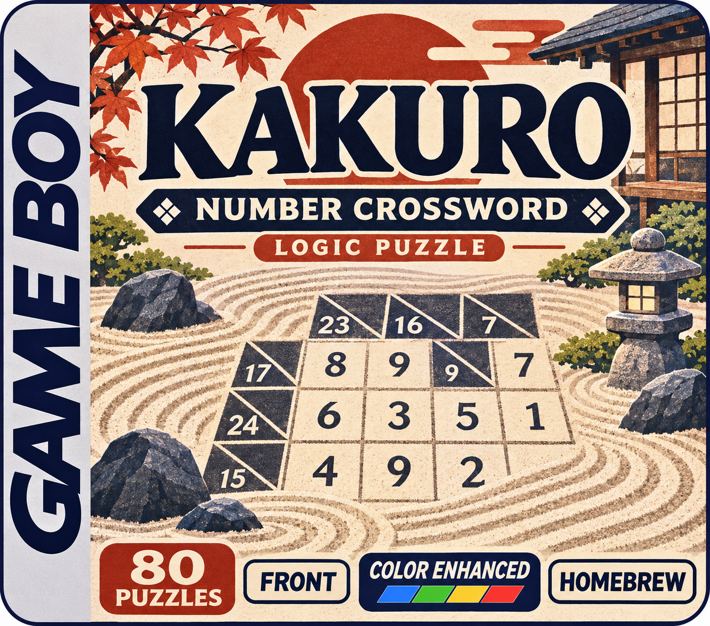
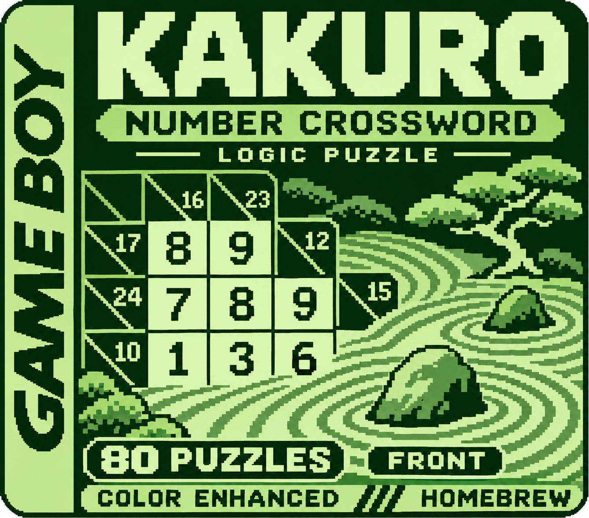
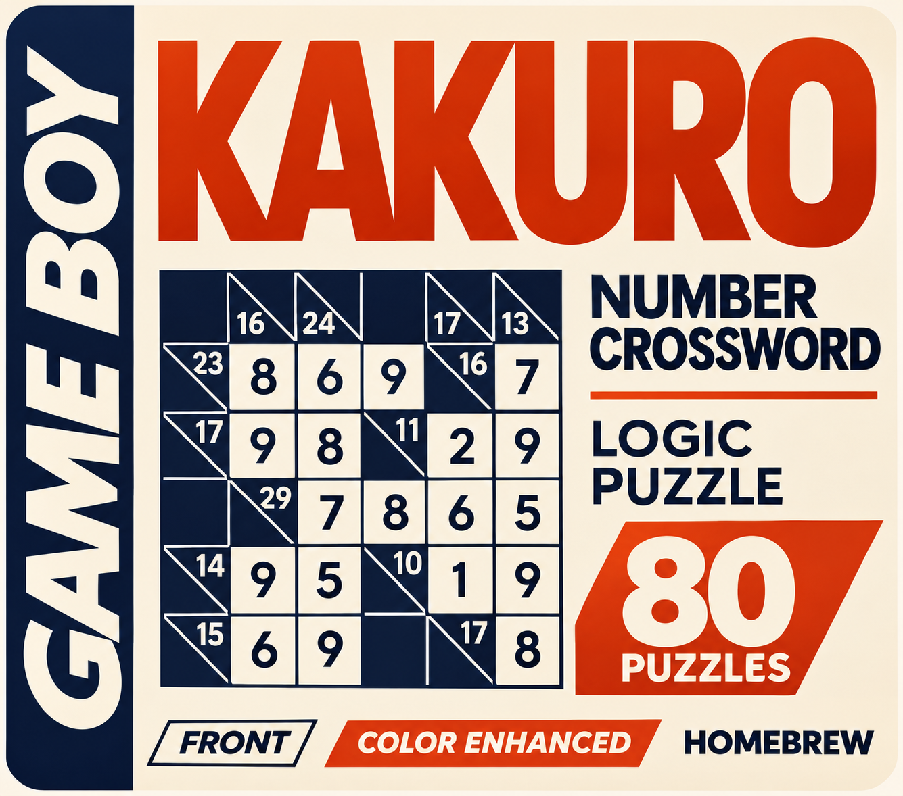
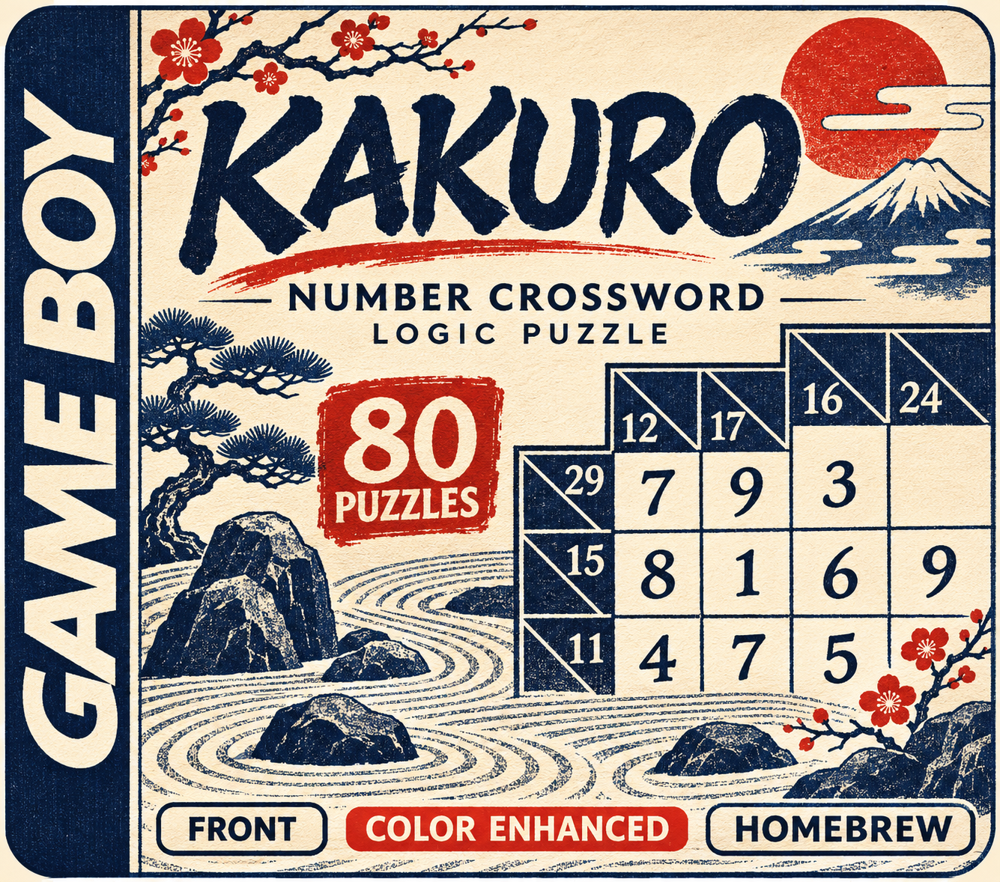
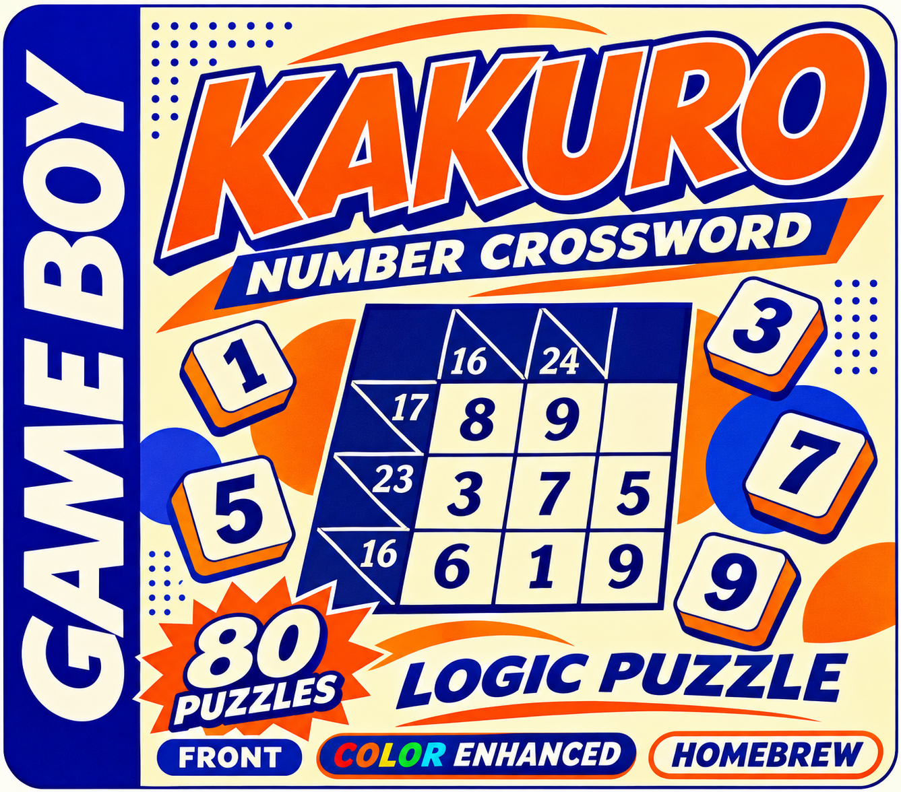

# Five cartridge sticker concepts

Generated using the built-in imagegen tool. Exact prompts are in `prompts.json`.
The reproducible production sticker is in the parent folder.

## zen garden

## classic green

## swiss grid

## indigo print

## color pop

