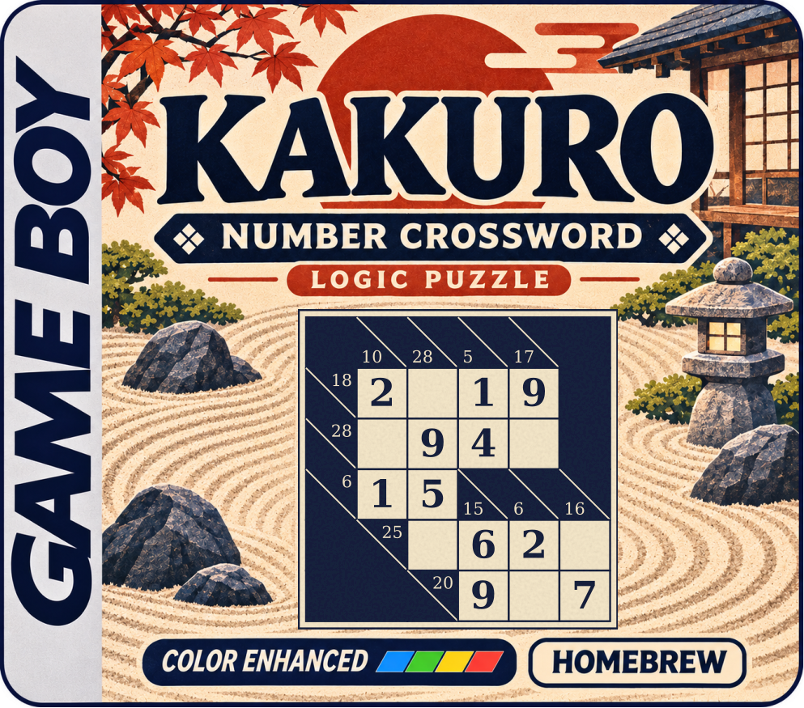
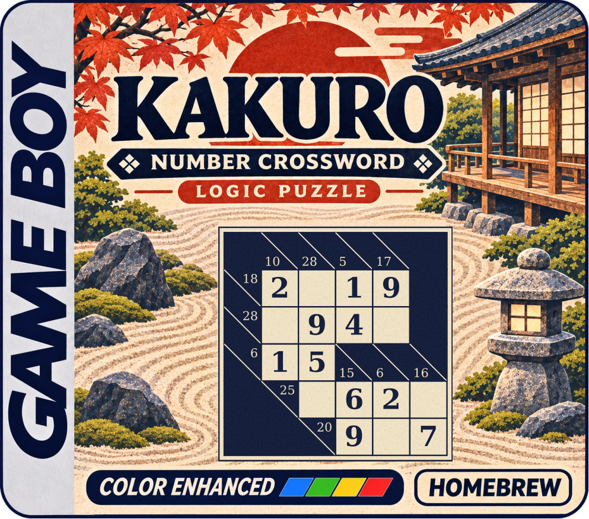
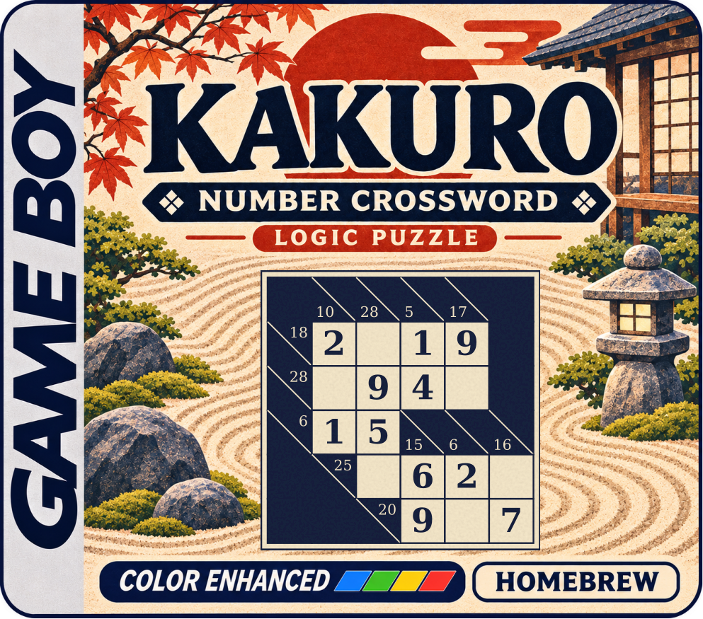
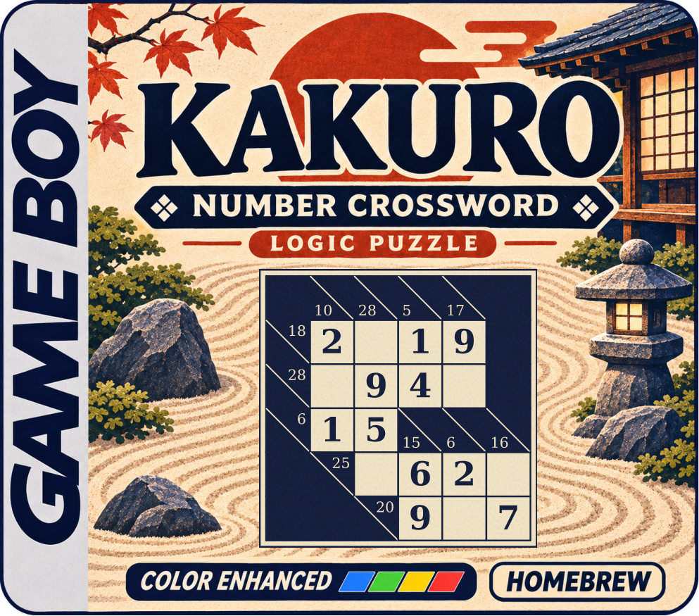
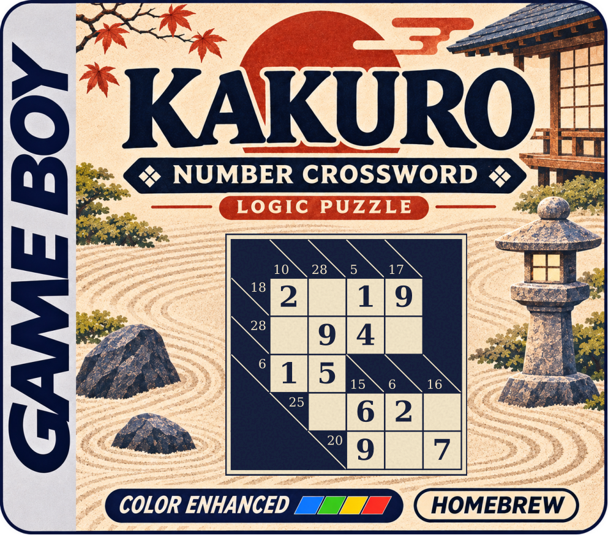

# Five revised zen-garden stickers

These follow the first concept's warm illustrated garden, navy serif title,
vermilion maple leaves and cream paper. They omit the puzzle count and FRONT.

Each final PNG, self-contained SVG and PDF contains the same complete 6 × 6
Kakuro board, rendered programmatically from `assets/puzzles/001.puz`.
The PDF and SVG trim size is 42 × 37 mm; PNG exports have 600 dpi metadata.

## 06 — Autumn garden

## 07 — Pavilion garden

## 08 — Maple and stone

## 09 — Evening garden

## 10 — Open zen garden

## Puzzle checks

Every across and down sum is computed from the stored solution. Each run uses
distinct digits from 1–9. The displayed partial board has exactly one solution,
verified with the project's backtracking solver. Across clues are in the
upper-right triangle and down clues in the lower-left triangle, matching the game.

`puzzle-proof.json` records the solution, displayed digits, every clue, solution
count and hashes of the puzzle region in the final PNGs. The build compares the
final puzzle pixels with `verified-board.png`; all five must match exactly.

## Artwork and rebuilding

The built-in imagegen tool generated the illustrations using the first concept
as a style reference. `backgrounds/` preserves those original generated images;
`prompts.json` records the exact prompts. Backgrounds reserve an empty space for
the verified board. No AI-generated puzzle digits are used in the final labels.

Run `make sticker-zen` to rebuild all five final labels. Requires Python 3,
Pillow, DejaVu Serif and `rsvg-convert` (librsvg2-bin). Print PDFs at 100% /
Actual size. The earlier concepts in `../concepts/` are retained as history.
