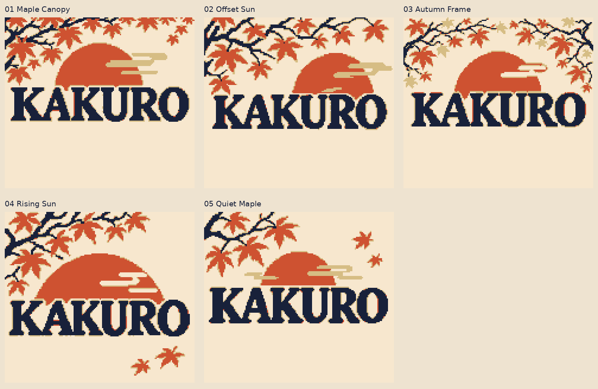
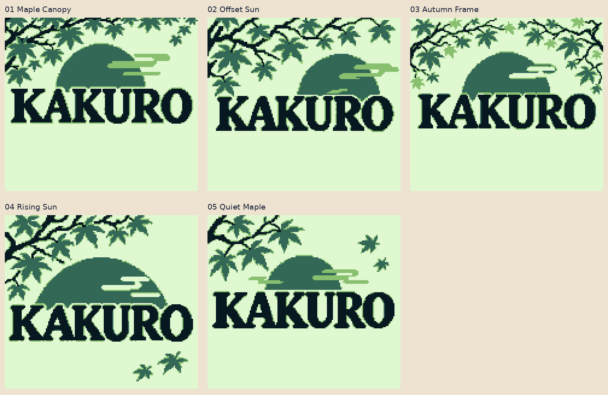

# Kakuro intro scene drafts

Five variations based on the selected cartridge label 07: the serif KAKURO
wordmark, sun, maple leaves and branches. Each native PNG is exactly **160 × 144
pixels**, opaque, and uses exactly **four colors**. No puzzle or cartridge text
is included. The lower area is quiet space for a future start prompt.

## Native-resolution files

| Draft | Warm palette | Original Game Boy green |
| --- | --- | --- |
| 01 — Maple canopy | [160 × 144 PNG](01-maple-canopy.png) | [160 × 144 PNG](01-maple-canopy-dmg.png) |
| 02 — Offset sun | [160 × 144 PNG](02-offset-sun.png) | [160 × 144 PNG](02-offset-sun-dmg.png) |
| 03 — Autumn frame | [160 × 144 PNG](03-autumn-frame.png) | [160 × 144 PNG](03-autumn-frame-dmg.png) |
| 04 — Rising sun | [160 × 144 PNG](04-rising-sun.png) | [160 × 144 PNG](04-rising-sun-dmg.png) |
| 05 — Quiet maple | [160 × 144 PNG](05-quiet-maple.png) | [160 × 144 PNG](05-quiet-maple-dmg.png) |

`*-4x.png` files show exact pixels enlarged 4× with nearest-neighbor scaling.
Comparison sheets are previews, not native-resolution assets.

## Palette and validation

The warm palette is cream `#F7E7CE`, sand `#D6BD84`, rust `#CE5231`, and navy
`#18213A`. The green palette is the same four-shade ramp used by the repository's
screenshot tools: `#E0F8D0`, `#88C070`, `#346856`, `#081820`.

`validation.json` records the dimensions, exact palette, unique 8 × 8 tile count
and tile export checks for each draft. PNGs use palette indices 0–3, light to
dark. The `.2bpp` and `.tilemap` files contain deduplicated Game Boy tiles and a
20 × 18 tile map. The exporter decodes the tiles again and checks every pixel
against the PNG. These are draft artwork exports; the ROM intro is unchanged.

## Source artwork and rebuilding

The built-in imagegen tool generated five concept illustrations using cartridge
design 07 as a reference. `sources/` contains those original high-resolution
concepts, and `prompts.json` records the exact prompts. The final native assets
are area-sampled to 160 × 144 and mapped to the fixed palette without dithering.

Run `python3 tools/build_intro_drafts.py` to reproduce the native PNGs, enlarged
previews, tile exports, comparisons and validation report. Requires Pillow.
